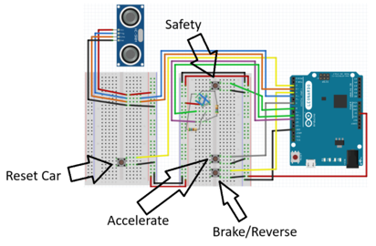

# How to use the controller

Place the alternate controller on the table in front of you, slightly to the right, where a computer mouse would be. Ensure that the ultrasonic sensor is aiming to the left. Plug the Leonardo into the computer and open the [Slow Roads](https://slowroads.io/) game in a browser.

The safety is on by default, so the light from the RGB LED will be red. When you are ready to play the game, press the button beside the RGB LED to toggle the safety. Hold your arm in front of the ultrasonic sensor to steer the car. The closer your arm is to the sensor, the more the car will turn right. The further away your arm is, the more the car will turn left.

To accelerate, brake, or reset the car back onto the road, press and hold the corresponding button.

To turn on/off the light from the RGB LED that shows the safety state, hold down the safety button for one second. Doing this does not change the safety state, and the safety button still works while the light is off.

The demo video can be watched [here](https://iadt-my.sharepoint.com/:v:/g/personal/n00233944_iadt_ie/IQBn2ivcAWMuQZZhgYnXTKaCAadlpz6UNqMiTQYw3t8yP58?e=WK8Iy6&nav=eyJyZWZlcnJhbEluZm8iOnsicmVmZXJyYWxBcHAiOiJTdHJlYW1XZWJBcHAiLCJyZWZlcnJhbFZpZXciOiJTaGFyZURpYWxvZy1MaW5rIiwicmVmZXJyYWxBcHBQbGF0Zm9ybSI6IldlYiIsInJlZmVycmFsTW9kZSI6InZpZXcifX0%3D).
